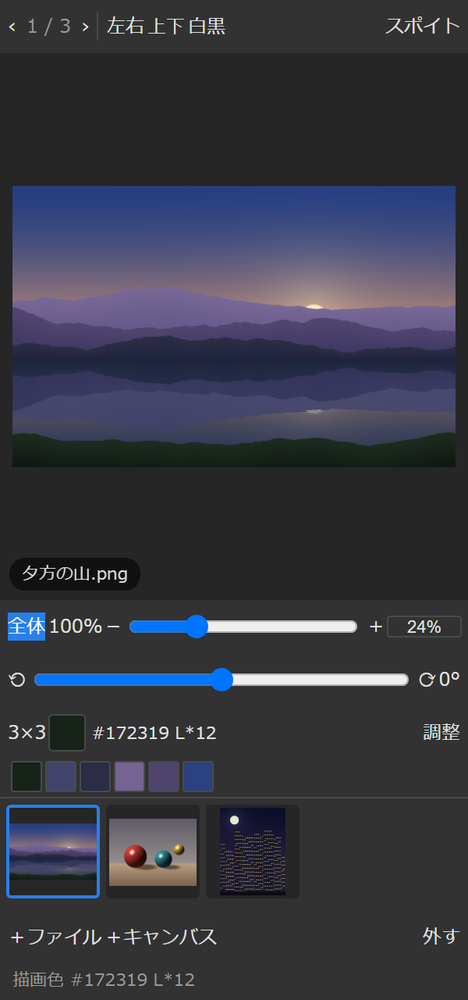
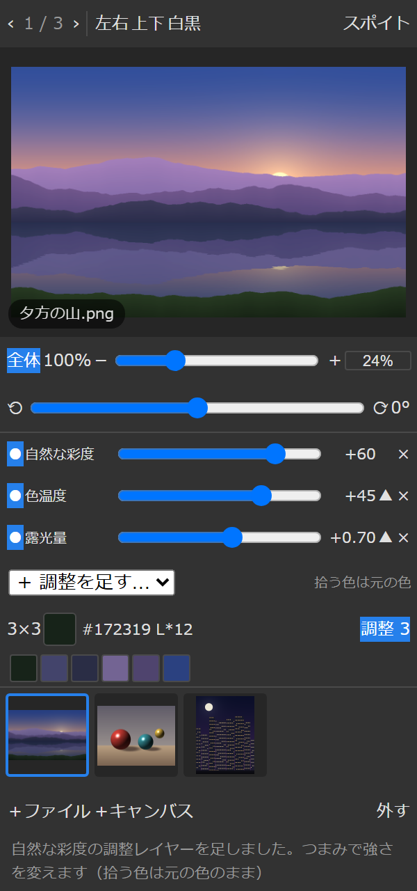
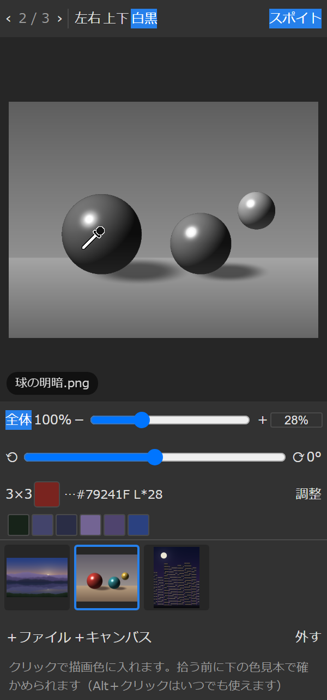
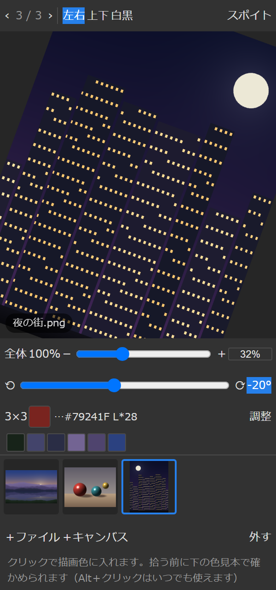

# サブビュー — CLIP STUDIO 風のサブビューを Photoshop に (UXP パネル)

CLIP STUDIO PAINT の「サブビュー」パレットに当たるものを Photoshop に足すパネルです。
資料を並べて、**拡大・移動・回転・反転・白黒・露光量や色温度の調整**で見ながら、**スポイトでそのまま描画色に入れ**られます。
いま描いているキャンバスを写して横に置き、**左右反転や白黒の見え方を描きながら確かめる**こともできます。

**[English version below](#english)**

<p align="center"></p>

> **免責事項**: 本パネルは**ご自身の責任**でお使いください。無保証です (MIT ライセンス)。開いた画像ファイルは読むだけで書き換えませんが、
> 使ったこと、または使えなかったことによって生じた損害について、作者は責任を負いかねます。

## 特長

- **資料を並べて送る**: PNG / JPEG を何枚でも。下の並びをクリックするか `←` `→` で送り、横へドラッグで並べ替え。
  並びと、画像ごとの向き・拡大・調整は、Photoshop を開き直しても戻ります
- **CLIP STUDIO と同じ見かたの操作**: ホイールで拡大 (カーソルの位置が中心)、ドラッグで移動、角度のつまみで自由に回転
  (0°・±90°・180° の近くで止まる)、左右・上下反転、**ダブルクリックで全体表示**
- **スポイトで描画色へ**: **Alt＋クリック**でいつでも拾える。1 画素 / 3×3 / 5×5 の平均、拾った色は 12 色まで残る。
  拾う前からカーソル下の色が見える
- **拾う色はいつも元の色**: 白黒・反転・回転・調整で見え方を変えていても、拾うのは元の画像の色
- **Lightroom 式の調整レイヤー**: 露光量・コントラスト・ハイライト・シャドウ・白レベル・黒レベル・色温度・色かぶり補正・自然な彩度・彩度。
  何枚でも重ねられ、1 枚ずつ止めて見比べられる。計算はリニアで、露光量で飛ばした所もハイライトで戻せる
- **いまのキャンバスを横に置く**: **＋キャンバス**で開いている書類を写す。**追従**を点けると、描くたびに約 1 秒おいて写し直す。
  左右反転・白黒を点けておけば、本体を反転せずに形の狂いや明暗を確かめられる
- **インターネットにつながない**: ネットワークを使う許可を取っていません。ファイルは開くときに選んだものだけを読みます
- **依存なし**: PNG (全形式・Adam7・16bit) と JPEG (ベースライン・プログレッシブ・CMYK) の読み込みも自前です

## 画面

| 資料を並べて色を拾う | 調整レイヤー (Lightroom 式) |
|---|---|
|  |  |
| 下の色見本が拾った色。下の並びで資料を送る | 露光量 +0.70・色温度 +45・自然な彩度 +60。上の行ほど後からかかる |
| **白黒で明暗を見る** | **回転・左右反転・拡大** |
|  |  |
| 白黒で見ていても、スポイトが拾うのは元の赤 (#79241F) | -20° に傾けて左右反転、32% に拡大 |

写真は、テスト用のブラウザ (Chromium) でパネルを開いて撮ったものです (`npm run shots`)。Photoshop の中では、ボタンや文字の見た目が少し違います。
資料の絵は、著作権の心配がないようにプログラムで描いたものです。

## 動作環境

| 項目 | 内容 |
|---|---|
| アプリ | Adobe Photoshop 2024 (25.0) 以降。Photoshop 2025 (26.11)・2026 で確認 |
| OS | Windows (Windows 11 で確認。Mac は試していません) |
| 形式 | UXP プラグイン (manifest v5)。`.ccx` を Creative Cloud で入れる |
| 開ける画像 | PNG・JPEG |
| パネルの幅 | 230px から (細くしてもはみ出さない作り) |

## 入れかた

1. [Releases](../../releases/latest) のページから **`subview.ccx`** をダウンロードする
2. ダウンロードした `subview.ccx` を**ダブルクリック**する。Creative Cloud が開き、入れてよいか聞かれるので **インストール** を押す
   (Adobe のマーケットプレイスを通していないプラグインなので、確認の表示が出ます)
3. Photoshop を起動 (起動していたら開き直す) し、メニューの **プラグイン → サブビュー** でパネルを開く

パネルを開いたまま Photoshop を閉じれば、次からは起動と同時に同じ場所に出ます。

- **新しい版にするとき**は、新しい `subview.ccx` を同じようにダブルクリックします
- **外すとき**は、Creative Cloud デスクトップの **プラグインを管理** からサブビューを削除します

## 使いかた

まず **＋ファイル** (PNG / JPEG) か **＋キャンバス** (いま開いている書類を写す) で資料を足します。
あとは、絵の上でドラッグして動かし、ホイールで拡大し、**Alt を押しながらクリック**するとその色が描画色に入ります。

| 操作 | やり方 |
|---|---|
| 資料を足す | **＋ファイル** (PNG / JPEG・複数可) / **＋キャンバス** (開いている書類を写す)。**今の画像のすぐ後ろ**に入って、すぐ出る |
| 送る | ‹ › ボタン、`←` `→`、下の並びをクリック |
| 拡大・縮小 | ホイール (カーソル位置を中心に)、＋ −、倍率の**つまみ**、`+` `-`、**Ctrl＋クリック**で拡大・**Ctrl＋Alt＋クリック**で縮小 |
| 倍率を数字で | 倍率の欄に `150` などと入れて Enter。倍率は元の画像の画素で数える (100% = 元の 1 画素) |
| 全体 / 等倍 | **全体**・**100%** ボタン、`0` `1`。絵を**ダブルクリック**するといつでも全体表示に戻る |
| 移動 | ドラッグ |
| 回転 | 角度の**つまみ** (0°・±90°・180° の近くで止まる)、**⟲ ⟳** で 15° ずつ (`R`・`Shift＋R`)、**0°** ボタンで戻す |
| 左右・上下反転・白黒 | **左右** (`H`)・**上下** (`V`)・**白黒** (`G`、明暗だけで見る)。回していても画面の左右・上下で返る |
| 見え方の調整 | **調整**を押して **＋ 調整を足す…** から選ぶ (下の表)。何枚でも重ねられ、**●/○** で止めて比べる・**▲** で順番を変える・**×** で消す |
| 色を拾う | **Alt＋クリック**でいつでも拾える。**スポイト** (`I`) を点けると、クリックだけで拾える。拾う前はカーソル下の色が下に出る |
| スポイトの範囲 | **1px / 3×3 / 5×5** のボタン (網点やノイズの多い資料は平均が効く) |
| 拾った色に戻す | 下の色見本を押す (最大 12 色) |
| 並べ替え | 下の並びを**横へドラッグ**、または `Ctrl＋←` `Ctrl＋→` |
| 並びから外す | **外す** (元のファイルは触らない)。並びを **Ctrl＋クリック**で印を付けると、**まとめて外す** |
| つまみを戻す | 角度・倍率・調整のつまみを**ダブルクリック**すると初めの値に戻る |

- キーは、パネルを一度クリックしてからのときだけ効きます (Photoshop 本体のショートカットとぶつけないため)
- 向き・拡大・調整は画像ごとに覚えていて、Photoshop を開き直しても並びごと戻ります (写したキャンバスは残りません)
- 調整・白黒は**見え方だけ**です。スポイトで拾う色は、いつも元の画像の色です

### 調整の項目 (Lightroom の「基本補正」に合わせた)

| 項目 | 幅 | 何が起きるか |
|---|---|---|
| 露光量 | -5.00〜+5.00 | 光の量を変える。+1 で 2 倍。色味は残る |
| コントラスト | ±100 | 真っ黒・真っ白・中間の灰色は動かさずに、明暗の差を広げる・狭める |
| ハイライト | ±100 | 明るい所だけ。下げると、露光量で白く飛んだ所も戻せる |
| シャドウ | ±100 | 暗い所だけを持ち上げる・沈める |
| 白レベル / 黒レベル | ±100 | いちばん明るい所・暗い所の位置を動かす |
| 色温度 | ±100 | + で黄 (暖かく)、- で青 |
| 色かぶり補正 | ±100 | + でマゼンタ、- で緑 |
| 自然な彩度 | ±100 | くすんだ色ほど強く効き、もう鮮やかな色はあまり動かさない |
| 彩度 | ±100 | -100 で灰色、+100 で 2 倍 |

- 下の行から順にかかります (上の行ほど後から)。白黒は、すべての調整の後にかかります
- Lightroom の考えかたに合わせた近似なので、同じ値でも Lightroom とまったく同じ見え方にはなりません

### キャンバスを横に出しておく

**＋キャンバス**は、いま開いている書類の見た目を写します。**追従**を点けておくと、描くたびに約 1 秒おいて写し直します。

- **左右**を点けておけば、本体を反転せずに**左右反転の見え方を常に横に置ける** (形の狂いの確認)
- **白黒**を点ければ、**明暗だけの見え方**を横に置ける
- 拡大して描いている間に、全体の構図を横で見ておける

### できないこと

- PSD・CLIP・TIFF・WebP などは直接開けません (PNG か JPEG に書き出してください)
- クリップボードからの読み込みと、ファイルのドラッグ＆ドロップにも対応していません (Photoshop のパネルが受け取れないため)

## ライセンス

MIT ([LICENSE](LICENSE))

## 開発

```
npm install
npm test            # 復号 (Pillow の出力と突き合わせ)・調整の計算 41 件、表示の計算 5 件
npm run test:ui     # Chromium で画面の通し 29 件 (photoshop / uxp は代わりの部品)
npm run shots       # README の画面写真を撮り直す (docs/images/)
npm run install:ps  # この PC の Photoshop に入れる (外すのは npm run install:ps -- -Remove)
npm run pack        # 配る subview.ccx を dist/ に作るだけ
```

- 直しながら試すときは、Creative Cloud から **UXP Developer Tool** を入れ、**Add Plugin** でこのフォルダの `manifest.json` を選んで **Load**、直したら **Reload**
- 依存はありません。PNG / JPEG の復号も自前です (UXP には zlib も canvas の画素読み出しも無いため)
- `test:ui` と `shots` は playwright を使います。「ブラウザが無い」と出たら `npx playwright install chromium`
- `test/fixtures/` の画像はテスト用に生成したものです

### フォルダ構成

```
photoshop-subview/
├─ manifest.json            UXP manifest v5。Photoshop 25.0 以降。ファイルは request (開くときに選んだものだけ)
├─ index.html, styles.css   パネル。色は Photoshop の明るさ設定に追従
├─ main.js                  画面の振る舞い (並び・表示・スポイト・キャンバス・調整)
├─ lib/
│  ├─ ps.js                 Photoshop に触るのはここだけ (描画色・キャンバスの取得・JPEG 化・通知)
│  ├─ view.js               拡大・移動の計算
│  ├─ imageops.js           縮小・回転・反転・白黒・調整・スポイト
│  └─ png.js, inflate.js, jpeg.js   PNG / JPEG の復号、表示用 PNG の書き出し
├─ icons/                   パネル・プラグインのアイコン、スポイトの絵
├─ test/                    codec-tests.js (Pillow と突き合わせ)・unit-tests.js・ui-smoke.js、fixtures/
├─ tools/
│  ├─ install.ps1           .ccx に詰めて、Adobe のインストーラ (UnifiedPluginInstallerAgent) で入れる
│  └─ screenshots.js        README の画面写真を撮る (資料の絵もここで描く)
└─ docs/images/             README の画面写真
```

### 守っていること

- **Photoshop の API は `lib/ps.js` の外で呼ばない。** ほかは Node で試せる形に保つ
- **スポイトは表示の向きを戻して元の画素から拾う** (`viewToSource`)。調整・白黒の影響を受けない
- **反転は画面の上でかける** (回転の後)。`renderRGB` / `viewToSource` / `sourceToView` は同じ順番で揃える (codec テストが往復で確かめている)
- 調整の計算はリニアで、途中は 1 を超えてよい。明るさの項目は輝度に単調な曲線をかけ、比で RGB を伸ばす (色相が回らない)
- **重い処理 (復号) は必要になってから・裏で。** 前後 2 枚は先読み

### Photoshop (UXP) のパネルで分かった癖

普通のブラウザと違い、実機で確かめて回り道を入れたところです。

- **wheel イベントが来ない** → 画像の上に見えないスクロール箱を重ね、そのスクロール量を拡大縮小に読み替える
- その箱が**押し下げを吸い取る** (pointerdown も mousedown も来ない) → 最初の「押したまま動いた」か「離した」を始まりとみなす
- その箱が**ダブルクリックの 2 回目も吸い取る** (dblclick も来ない) → クリックの直後 0.5 秒だけ箱を外す
- **CSS の cursor が効かない** → スポイトの絵をマウスの先に重ねて動かす
- `selected` 属性ではボタンの見た目がほぼ変わらない → 点いている間は色を直接付ける
- zip の中の名前が「\」区切りだと、UXP は `lib/` の中を見つけられない (PowerShell 5 の Compress-Archive がそう書く) → .NET の ZipFile で「/」区切りにして詰める

## 注意・未確認の項目

- Photoshop 2025 (26.11) の実機で確認しながら作っています。実機でまだ確認していないもの:
  倍率のつまみ・倍率の打ち込み・Ctrl＋クリックでの拡大、並びのドラッグでの並べ替え、印を付けてまとめて外す、
  Releases の `subview.ccx` をダブルクリックで入れる流れ
- Mac では試していません

---

# English

**Subview** adds a panel like CLIP STUDIO PAINT's **Sub View** palette to Photoshop.
Line up your reference images, look at them **zoomed, rotated, flipped, in grayscale, or with exposure and color adjustments**,
and **pick colors straight into your foreground color**. You can also keep a snapshot of the canvas you are painting beside you,
mirrored or in grayscale, to check shapes and values as you go.

<p align="center"></p>

> **Disclaimer**: Use this panel at your own risk. It comes with no warranty (MIT License). It only reads the image files
> you open and never writes to them, but the author accepts no liability for any damage arising from its use or inability to use it.

## Features

- **Line up references**: any number of PNG / JPEG files. Step through them by clicking the strip or with `←` `→`,
  drag sideways to reorder. The list, and each image's rotation, zoom and adjustments, come back when you restart Photoshop
- **CLIP STUDIO-style viewing**: wheel to zoom (around the cursor), drag to pan, free rotation with an angle slider
  (snaps near 0°, ±90°, 180°), horizontal and vertical flip, **double-click to fit**
- **Eyedropper into the foreground color**: **Alt+click** at any time. 1 px / 3×3 / 5×5 averaging, the last 12 colors are kept,
  and the color under the cursor is previewed before you pick
- **Always picks the original color**: even in grayscale, flipped, rotated or adjusted, the picked color is the image's own
- **Lightroom-style adjustment layers**: Exposure, Contrast, Highlights, Shadows, Whites, Blacks, Temperature, Tint, Vibrance, Saturation.
  Stack as many as you like and toggle each one to compare. Computed in linear light, so Highlights can recover what Exposure blew out
- **Keep your canvas beside you**: **＋キャンバス** (*+Canvas*) takes a snapshot of the open document; with **追従** (*Follow*) on it
  refreshes about a second after each stroke. Turn on flip or grayscale to check distortions and values without touching the real canvas
- **Never goes online**: the plugin does not request network access, and only reads the files you pick
- **No dependencies**: PNG (all types, Adam7, 16-bit) and JPEG (baseline, progressive, CMYK) decoding is built in

## Screens

| References and picked colors | Adjustment layers (Lightroom-style) |
|---|---|
|  |  |
| Picked colors are the swatches at the bottom; the strip steps through references | Exposure +0.70, Temperature +45, Vibrance +60. Upper rows apply later |
| **Grayscale to check values** | **Rotate, flip, zoom** |
|  |  |
| Viewed in grayscale, yet the eyedropper picks the original red (#79241F) | Tilted -20°, flipped horizontally, zoomed to 32% |

Captured by opening the panel in a test browser (Chromium; `npm run shots`). Buttons and text look slightly different inside Photoshop.
The reference images are drawn by the script itself, so there are no copyright concerns.

## Requirements

| Item | |
|---|---|
| App | Adobe Photoshop 2024 (25.0) or later. Tested with Photoshop 2025 (26.11) and 2026 |
| OS | Windows (tested on Windows 11; not tried on Mac) |
| Format | UXP plugin (manifest v5), installed from a `.ccx` through Creative Cloud |
| Images | PNG, JPEG |
| Panel width | 230 px and up (built not to overflow when narrow) |

## Install

1. Download **`subview.ccx`** from the [Releases](../../releases/latest) page
2. **Double-click** `subview.ccx`. Creative Cloud opens and asks for confirmation — click **Install**
   (you will see a warning because the plugin is not distributed through the Adobe Marketplace)
3. Start Photoshop (restart it if it was running) and open the panel from **Plugins → サブビュー (Subview)**

If you leave the panel open when you quit Photoshop, it comes back in the same place next time.

- **To update**, double-click the new `subview.ccx` the same way
- **To uninstall**, remove Subview from **Manage plugins** in the Creative Cloud desktop app

> The panel's labels are in Japanese. The table below gives the English meaning of each button.

## How to use

Add images with **＋ファイル** (*+File*: PNG / JPEG) or **＋キャンバス** (*+Canvas*: a snapshot of the open document).
Then drag to pan, use the wheel to zoom, and **Alt+click** to put the color under the cursor into your foreground color.

| Action | How |
|---|---|
| Add images | **＋ファイル** (*+File*, PNG / JPEG, multiple allowed) / **＋キャンバス** (*+Canvas*). New images go **right after the current one** and are shown immediately |
| Next / previous | ‹ › buttons, `←` `→`, or click the strip at the bottom |
| Zoom | Mouse wheel (around the cursor), ＋ −, the zoom **slider**, `+` `-`, **Ctrl+click** to zoom in, **Ctrl+Alt+click** to zoom out |
| Type a zoom level | Type e.g. `150` in the zoom box and press Enter. Zoom counts the original image's pixels (100% = one source pixel) |
| Fit / 100% | **全体** (*Fit*) and **100%** buttons, `0` `1`. **Double-click** the image to go back to Fit at any time |
| Pan | Drag |
| Rotate | The angle **slider** (snaps near 0°, ±90°, 180°), **⟲ ⟳** for 15° steps (`R`, `Shift+R`), **0°** button to reset |
| Flip / grayscale | **左右** (*flip horizontal*, `H`), **上下** (*flip vertical*, `V`), **白黒** (*grayscale*, `G`, values only). Flips act on the screen even when rotated |
| Adjustments | Click **調整** (*Adjust*) and choose from **＋ 調整を足す…** (*+ Add adjustment*, see below). Stack as many as you like; **●/○** toggles one off to compare, **▲** moves it up, **×** removes it |
| Pick a color | **Alt+click** at any time. Turn on **スポイト** (*Eyedropper*, `I`) to pick with a plain click. The color under the cursor is previewed before you pick |
| Sample size | **1px / 3×3 / 5×5** button (averaging helps with halftones and noise) |
| Reuse a color | Click a swatch at the bottom (up to 12) |
| Reorder | **Drag sideways** in the strip, or `Ctrl+←` `Ctrl+→` |
| Remove from the list | **外す** (*Remove*; the file itself is untouched). **Ctrl+click** items in the strip to mark several, then remove them together |
| Reset a slider | **Double-click** the angle, zoom or adjustment slider |

- Keys work only after you click the panel once (so they don't clash with Photoshop's shortcuts)
- Rotation, zoom and adjustments are remembered per image, and the list comes back when you restart Photoshop (canvas snapshots are not kept)
- Adjustments and grayscale only change **how the image looks**. The eyedropper always picks the original color

### Adjustments (modeled on Lightroom's Basic panel)

| Adjustment | Range | What it does |
|---|---|---|
| 露光量 Exposure | -5.00 to +5.00 | Changes the amount of light. +1 doubles it. Colors are kept |
| コントラスト Contrast | ±100 | Widens or narrows the tonal spread without moving pure black, pure white or middle gray |
| ハイライト Highlights | ±100 | Bright areas only. Lowering it can recover areas blown out by Exposure |
| シャドウ Shadows | ±100 | Lifts or deepens dark areas only |
| 白レベル Whites / 黒レベル Blacks | ±100 | Moves the brightest / darkest points |
| 色温度 Temperature | ±100 | + toward yellow (warmer), - toward blue |
| 色かぶり補正 Tint | ±100 | + toward magenta, - toward green |
| 自然な彩度 Vibrance | ±100 | Affects muted colors most and leaves already-vivid colors mostly alone |
| 彩度 Saturation | ±100 | -100 is gray, +100 doubles it |

- Layers apply from the bottom row up (upper rows later). Grayscale comes after all adjustments
- These follow Lightroom's approach but are an approximation, so the same values will not look exactly the same as in Lightroom

### Keep your canvas beside you

**＋キャンバス** takes a snapshot of how the open document looks. With **追従** (*Follow*) on, it refreshes about a second after each stroke.

- With **左右** on, you can keep a **mirrored view** beside you without flipping the real canvas (great for spotting distortions)
- With **白黒** on, you can keep a **values-only view** beside you
- While working zoomed in, you can keep the whole composition in view

### Not supported

- PSD, CLIP, TIFF, WebP and other formats cannot be opened directly (export to PNG or JPEG)
- Pasting from the clipboard and dragging files onto the panel are not supported (Photoshop panels cannot receive them)

## License

MIT ([LICENSE](LICENSE))

## Development

```
npm install
npm test            # decoders (checked against Pillow) and adjustment math: 41, view math: 5
npm run test:ui     # end-to-end UI tests in Chromium: 29 (photoshop / uxp are stubbed)
npm run shots       # retake the README screenshots (docs/images/)
npm run install:ps  # install into Photoshop on this PC (uninstall: npm run install:ps -- -Remove)
npm run pack        # just build dist/subview.ccx for distribution
```

- To try changes live, install **UXP Developer Tool** from Creative Cloud, **Add Plugin** → pick this folder's `manifest.json`, **Load**, and **Reload** after edits
- No dependencies. PNG / JPEG decoding is built in (UXP has neither zlib nor canvas pixel access)
- `test:ui` and `shots` use playwright. If it says the browser is missing, run `npx playwright install chromium`
- The images in `test/fixtures/` were generated for testing

### Folder layout

```
photoshop-subview/
├─ manifest.json            UXP manifest v5, Photoshop 25.0+. File access is request (only files you pick)
├─ index.html, styles.css   The panel. Colors follow Photoshop's brightness setting
├─ main.js                  Panel behavior (list, view, eyedropper, canvas, adjustments)
├─ lib/
│  ├─ ps.js                 The only place that talks to Photoshop (foreground color, canvas capture, JPEG encoding, notifications)
│  ├─ view.js               Zoom and pan math
│  ├─ imageops.js           Downscaling, rotation, flips, grayscale, adjustments, color sampling
│  └─ png.js, inflate.js, jpeg.js   PNG / JPEG decoders; PNG writer for display
├─ icons/                   Panel and plugin icons, the eyedropper image
├─ test/                    codec-tests.js (vs Pillow), unit-tests.js, ui-smoke.js, fixtures/
├─ tools/
│  ├─ install.ps1           Packs a .ccx and installs it with Adobe's installer (UnifiedPluginInstallerAgent)
│  └─ screenshots.js        Takes the README screenshots (and draws the reference images)
└─ docs/images/             README screenshots
```

### Design rules

- **Photoshop APIs are called only from `lib/ps.js`**; everything else stays testable in Node
- **The eyedropper maps the screen position back to the original pixels** (`viewToSource`), unaffected by adjustments or grayscale
- **Flips are applied on screen** (after rotation). `renderRGB` / `viewToSource` / `sourceToView` share the same order (round-trip checked by the codec tests)
- Adjustments are computed in linear light and may exceed 1 midway. Tone controls apply monotonic curves to luminance and scale RGB by the ratio (no hue shifts)
- **Heavy work (decoding) happens only when needed, in the background.** The two neighbors are preloaded

### Quirks of Photoshop (UXP) panels we worked around

Found by testing in Photoshop; they differ from a normal browser.

- **No `wheel` events** → an invisible scroll box sits over the image and its scroll amount is turned into zoom
- That box **swallows pointer-down** (neither pointerdown nor mousedown arrives) → the first "moved with button held" or "released" event is treated as the start
- That box **also swallows the second click of a double-click** (no dblclick either) → the box is removed for 0.5 s after each click
- **CSS `cursor` has no effect** → an eyedropper image follows the mouse instead
- The `selected` attribute barely changes how a button looks → active buttons are colored directly
- With `\` separators inside the zip, UXP cannot find files under `lib/` (PowerShell 5's Compress-Archive writes them that way) → the package is built with .NET's ZipFile using `/`

## Notes and untested items

- Developed while testing on Photoshop 2025 (26.11). Not yet confirmed on a real install:
  the zoom slider, typed zoom and Ctrl+click zoom, reordering by dragging the strip, marking and removing several at once,
  and installing the Releases `subview.ccx` by double-clicking
- Not tried on Mac
